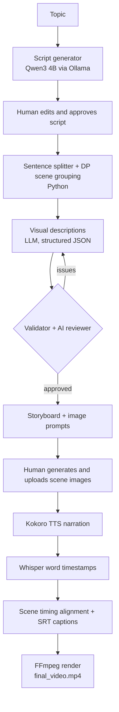

# 🎬 Shorts Studio

**A local-first, human-in-the-loop pipeline that turns a topic into a ready-to-upload YouTube Short**: script, storyboard, voiceover, synced captions and a final 1080×1920 video.

Built around a psychology and human-behaviour niche, running entirely on a MacBook Air M1 (8 GB) with **zero inference cost**.


<!-- 📺 Example Short: https://www.youtube.com/shorts/4_WepRf3IEk -->

---

## Why I built this

Making a consistent 45-second Short takes hours: writing a tight script, planning visuals, recording a voiceover, syncing captions, rendering. Fully automated tools tend to produce unreliable output, and paid APIs add recurring cost.

Shorts Studio automates the repetitive parts, keeps a **human approval step** at the points where quality matters, and uses small local models so each video costs nothing to produce.

## What it does

1. **Script**: a local LLM (Qwen3 4B via Ollama) writes a ~100-110 word script on one psychology concept. You can edit and approve it.
2. **Scene planning**: Python splits the script into sentences and groups them into 6-8 scenes. The LLM only writes a *visual description* per scene.
3. **Quality gates**: a rule-based validator and an AI reviewer check the storyboard before you see it.
4. **Images (manual)**: the app gives you a master illustration prompt and a prompt per scene. You generate the images in the tool of your choice and upload them.
5. **Voice**: Kokoro TTS generates the narration.
6. **Captions & timing**: Whisper produces word-level timestamps, which are aligned to scenes and turned into captions.
7. **Render**: FFmpeg assembles a 1080×1920, 30 fps video with burned-in captions and audio.

## Architecture



## Design decisions

- **The LLM never rewrites the narration.** Python splits the approved script into sentences and groups them into scenes; the LLM only writes visual descriptions. A validator then checks that the combined scene narration exactly matches the approved script. This removes the usual LLM drift (dropped or reworded sentences).
- **Structured output everywhere.** Every LLM call returns JSON validated by a Pydantic schema, so malformed output fails loudly instead of silently corrupting later steps.
- **Two-layer quality checks.** Deterministic Python rules catch structural problems (scene count, numbering, missing or duplicate sentences, narration preservation). An AI reviewer judges only subjective visual quality, and only *critical* issues can reject a storyboard. A controller module can feed issues back into regeneration for up to 3 attempts.
- **Human-in-the-loop by design.** Script approval and image creation are deliberately manual. This keeps quality under control and keeps cost at zero.
- **Swappable LLM layer.** All model calls go through `src/llm.py`, so the provider (currently Ollama) can be changed without touching the pipeline.
- **Local-first.** Moved from the OpenAI API to a local Ollama model, which removed per-video cost.
- **Robust caption timing.** Whisper's transcript is fuzzy-aligned to the known narration, so a misheard word, a hyphenated word or a number does not break scene timing.
- **Project folders.** Each video lives in `output/video_NNN/` with its script, storyboard, images, audio, captions and timings, which makes runs reproducible and easy to inspect.

## Tech stack

| Area | Tools |
|---|---|
| Language | Python |
| UI | Streamlit |
| LLM | Ollama, `qwen3:4b` |
| Data validation | Pydantic |
| Text-to-speech | Kokoro (MLX) |
| Word timestamps | faster-whisper |
| Video rendering | FFmpeg |

## Project structure

```
shorts-studio/
├── app.py                      # Streamlit app (script → storyboard → images → video)
├── src/
│   ├── llm.py                  # Central LLM layer (Ollama)
│   ├── project_manager.py      # Creates output/video_NNN project folders
│   ├── script_generator/       # Topic → script (Pydantic-validated)
│   ├── scene_planner/          # Sentence splitting, scene grouping, visual descriptions
│   ├── scene_tester/           # Validator, AI reviewer, retry controller
│   └── video_renderer/
│       └── pipeline.py         # TTS → timestamps → captions → FFmpeg (runs in voice_env)
├── tests/                      # Unit tests (splitter, grouping)
├── scripts/                    # Demo scripts that call the LLM
├── samples/video_001/          # Example outputs (script, storyboard, timings, captions)
├── legacy/                     # Early prototypes kept for reference
├── requirements.txt            # Main app environment
└── requirements-voice.txt      # Voice/render environment
```

## Setup

The project uses **two Python environments**: the main app environment, and a separate `voice_env` for the voice/render step. Voice and Whisper dependencies are heavy and independent of the app, so they are kept apart.

### Prerequisites

- macOS on Apple Silicon (developed on a MacBook Air M1, 8 GB; Kokoro runs on MLX)
- Python 3.10+
- [Ollama](https://ollama.com)
- FFmpeg with subtitle support (`libass`)

### 1. Clone and create the main environment

```bash
git clone https://github.com/AnanyaJohny/shorts-studio.git
cd shorts-studio

python3 -m venv venv
source venv/bin/activate
pip install -r requirements.txt
```

### 2. Create the voice environment

```bash
python3 -m venv voice_env
voice_env/bin/pip install -r requirements-voice.txt
```

The app expects it at `voice_env/` in the project root.

### 3. Install FFmpeg

```bash
brew install ffmpeg-full
```

The renderer looks for FFmpeg at `/opt/homebrew/opt/ffmpeg-full/bin/ffmpeg`. If yours is installed elsewhere, update the path in `src/video_renderer/pipeline.py`.

### 4. Pull the model

```bash
ollama pull qwen3:4b
```

### 5. (Optional) Configure

```bash
cp .env.example .env
```

| Variable | Default | Description |
|---|---|---|
| `LLM_PROVIDER` | `ollama` | LLM provider |
| `OLLAMA_URL` | `http://localhost:11434/api/generate` | Ollama endpoint |
| `LLM_MODEL` | `qwen3:4b` | Model name |

## Usage

Make sure Ollama is running, then:

```bash
streamlit run app.py
```

1. **Enter a topic** and click **Generate Short**.
2. **Review the script**, edit it if needed, and approve it.
3. **Review the storyboard** and the quality review.
4. **Generate the scene images** using the master illustration prompt and each scene's prompt, then **upload one image per scene**.
5. Click **Generate Video**. The final MP4 appears in the app, ready to download.

You can also render an existing project from the command line:

```bash
voice_env/bin/python -m src.video_renderer.pipeline --project-id video_001
```

### Output

```
output/video_001/
├── script.json
├── storyboard.json
├── images/scene_01.png … scene_07.png
├── audio/narration.wav, timestamps.json, captions.srt
├── scene_timings.json
└── final_video.mp4
```

See `samples/video_001/` for example script, storyboard, timing and caption files.

## Tests

```bash
pip install pytest
python -m pytest tests -q
```

Scripts in `scripts/` run the LLM stages end to end, for example:

```bash
python -m scripts.demo_pipeline
```

## Limitations

- **Images are manual.** Scene images are generated outside the app and uploaded. This is a deliberate human-in-the-loop choice, but it is not yet automated.
- **Small local model.** Qwen3 4B is fast and free but can produce uneven script quality, so script approval is a required step.
- **Apple Silicon only** for the voice step, because Kokoro runs on MLX.
- **Single niche and style:** psychology topics, minimalist black stickman visuals.
- The retry controller (up to 3 regeneration attempts) is used by the demo scripts; the Streamlit app currently does a single generation pass.

## Roadmap

- [ ] Wire the retry controller into the Streamlit app
- [ ] Automated image generation behind an interface, so any image model can be plugged in
- [ ] Final quality checker (audio, caption and video checks before approval)
- [ ] Progress display during rendering
- [ ] Batch mode for producing multiple Shorts
- [ ] Support for other niches and visual styles

## Results

<!-- Update with your real numbers -->
- First Short published on YouTube: ~430 views overnight
- Cost per video: ₹0 (local inference)

## Author

**Ananya Johny**: Software Engineer
[LinkedIn](<your-linkedin-url>) · [GitHub](https://github.com/AnanyaJohny)
